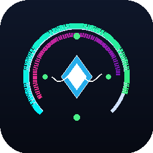

# 🪐 Antigravity Quota & Context Monitor

  

  <strong>Monitor nativo em tempo real de cotas de IA (Gemini & Claude), telemetria de tokens de contexto, limpeza de cache e compactação para o Antigravity IDE.</strong>

  
  
  
  
  

  🌐 <strong>Language Navigation / Navegação de Idioma:</strong> 
  <a href="#-português">🇧🇷 Português</a> &nbsp;|&nbsp;
  <a href="#-english">🇺🇸 English</a> &nbsp;|&nbsp;
  <a href="#-español">🇪🇸 Español</a> &nbsp;|&nbsp;
  <a href="#-简体中文">🇨🇳 简体中文</a>

---

## 🇧🇷 Português

### Visão Geral
O **Antigravity Quota & Context Monitor** é uma extensão nativa, ultra-leve e de alto desempenho desenvolvida especialmente para o **Google Antigravity IDE** (compatível com a versão mais recente **v1.107.0+** e arquitetura Antigravity 2.0).

Ela elimina a necessidade de adivinhar o consumo dos seus modelos de inteligência artificial ou sofrer interrupções inesperadas de cota durante o desenvolvimento assistido por agentes.

### Principais Recursos
* 📊 **Monitoramento Duplo de Cotas**:
  * **Ciclo Curto (5h)**: Acompanhe o percentual restante dos modelos Gemini e Claude em janelas de 5 horas.
  * **Cota Semanal & Vencimento Exato**: Exibe a porcentagem semanal restante com data, hora local de vencimento (`01/11 12:37`) e contagem regressiva (`em 2d 19h`).
* 🧠 **Telemetria Completa da Janela de Contexto**:
  * Volume acumulado de tokens na sessão ativa do agente (ex: `85k tokens / 1M`).
  * **⚡ Taxa de Aproveitamento de Cache (`Cache Read`)**: Identifique instantaneamente se seu contexto está usufruindo de cache rápido sem consumo integral de cota.
  * Tokens novos gerados na última interação.
* 🧹 **Limpeza de Armazenamento & Compactação SQLite**:
  * O Antigravity IDE acumula centenas de megabytes em bancos de dados de sessões passadas.
  * Com 1 clique, exclua sessões órfãs mantendo as 5 mais recentes e execute `VACUUM` no banco SQLite para desfragmentar e recuperar espaço em disco.
* 🗜️ **Compactação de Contexto Ativo (`/compact`)**:
  * Atalho rápido para focar a janela de chat do agente e aplicar o comando `/compact`, sumarizando o histórico sem perder o contexto do projeto.
* 🔄 **Reinicialização de Serviços do Agente**:
  * Reinicie com 1 clique o Language Server e o User Status Updater em caso de lentidão ou travamento de sockets.
* 🎨 **Interface 100% Nativa (Sem Webviews)**:
  * Não sobrecarrega a CPU nem a memória com navegadores embutidos. Usa apenas componentes nativos do IDE (`StatusBarItem` e `QuickPick`).
  * Coloração inteligente: Verde (> 30%), Amarelo (10% a 30%) e Vermelho (< 10%).

### Compatibilidade Certificada
* ✅ **Google Antigravity IDE**: `v1.107.0` ou superior.
* ✅ **Protocolo de Comunicação**: Connect Protocol v1 (HTTP/HTTPS) com suporte a daemons modernos `agy` e legados `language_server`.
* ✅ **Sistemas Operacionais**: macOS (Apple Silicon & Intel), Windows 10/11 e Linux (x64 & ARM64).

---

## 🇺🇸 English

### Overview
**Antigravity Quota & Context Monitor** is a native, ultra-lightweight, and high-performance extension specifically engineered for the **Google Antigravity IDE** (fully compatible with **v1.107.0+** and the Antigravity 2.0 architecture).

It removes the guesswork from monitoring your AI model quotas and prevents unexpected interruptions during agent-driven pair programming.

### Key Features
* 📊 **Dual Quota Monitoring**:
  * **5-Hour Limit**: Real-time remaining percentage for Gemini and Claude models with short-cycle reset countdowns.
  * **Weekly Limit & Exact Expiration**: Track your weekly allowance with localized expiration date and time (`01/11 12:37`) and human-readable countdowns (`in 2d 19h`).
* 🧠 **Active Session Context Telemetry**:
  * Live token consumption in your active agent context (e.g., `85k tokens / 1M`).
  * **⚡ Cache Read Hit Rate**: Know immediately whether your context is benefiting from prompt caching to preserve quotas and minimize latency.
  * New / generated token metrics.
* 🧹 **Disk Storage Cleaner & SQLite Vacuuming**:
  * Antigravity accumulates database files for every conversation.
  * Free up hundreds of megabytes in a single click: cleans orphaned conversations while preserving your 5 most recent tasks, followed by an automatic SQLite `VACUUM` compaction.
* 🗜️ **Context Compaction Shortcut (`/compact`)**:
  * One-click action to focus the agent chat and stage the native `/compact` command to streamline your context window.
* 🔄 **Agent Service Recovery**:
  * Restart the Antigravity Language Server and User Status Updater instantly when encountering socket deadlocks.
* 🎨 **100% Native Architecture (No Webviews)**:
  * Zero memory bloat. Built strictly using native `StatusBarItem` and `QuickPick` components with contextual color alerts (Green > 30%, Yellow 10-30%, Red < 10%).

### Certified Compatibility
* ✅ **Google Antigravity IDE**: `v1.107.0` and newer.
* ✅ **Transport**: HTTP/HTTPS Connect Protocol v1 with automatic daemon discovery (`agy` and `language_server`).
* ✅ **Cross-Platform**: macOS (Apple Silicon / Intel), Windows 10/11, and Linux.

---

## 🇪🇸 Español

### Descripción General
**Antigravity Quota & Context Monitor** es una extensión nativa, ultraligera y de alto rendimiento diseñada específicamente para el **Google Antigravity IDE** (plenamente compatible con la versión **v1.107.0+** y Antigravity 2.0).

Permite supervisar en tiempo real el consumo de cuotas de modelos de IA y el estado de la ventana de contexto sin interrumpir su flujo de desarrollo.

### Características Principales
* 📊 **Monitoreo Dual de Cuotas**:
  * **Ciclo Corto (5h)**: Porcentaje restante de modelos Gemini y Claude con cuenta regresiva de renovación.
  * **Cuota Semanal y Fecha de Vencimiento**: Visualización de la cuota semanal con fecha y hora local exacta de expiración (`01/11 12:37`) y tiempo restante (`en 2d 19h`).
* 🧠 **Telemetría de Ventana de Contexto**:
  * Tokens acumulados en la sesión activa del agente (ej: `85k tokens / 1M`).
  * **⚡ Tasa de Aprovechamiento de Caché (`Cache Read`)**: Verifique al instante si su contexto está aprovechando la caché sin consumir cuota completa.
* 🧹 **Limpieza de Almacenamiento y Compactación SQLite**:
  * Libera cientos de megabytes en disco eliminando conversaciones antiguas (conservando las 5 más recientes) y ejecutando `VACUUM` en las bases de datos locales.
* 🗜️ **Compactación de Contexto (`/compact`)**:
  * Atajo para enfocar el chat del agente y aplicar el comando nativo `/compact` para optimizar el historial.
* 🔄 **Reinicio de Servicios del Agente**:
  * Reinicie el Language Server y el actualizador de estado del Antigravity con un solo clic.
* 🎨 **Interfaz 100% Nativa**:
  * Cero Webviews o sobrecarga de navegador. Colores adaptativos: Verde (> 30%), Amarillo (10%-30%) y Rojo (< 10%).

### Compatibilidad Certificada
* ✅ **Google Antigravity IDE**: `v1.107.0` o superior.
* ✅ **Sistemas Operativos**: macOS, Windows y Linux.

---

## 🇨🇳 简体中文

### 概述
**Antigravity Quota & Context Monitor** 是专为 **Google Antigravity IDE**（完全兼容 **v1.107.0+** 及 Antigravity 2.0 架构）打造的原生、超轻量、高性能配额与会话上下文监视插件。

随时掌握 AI 模型的配额消耗与上下文窗口状态，避免编程中断。

### 核心功能
* 📊 **双重配额实时监控**：
  * **5小时短周期配额**：实时显示 Gemini 和 Claude 模型的剩余百分比及重置倒计时。
  * **每周配额与到期时间**：清晰呈现每周剩余配额百分比、本地化到期具体日期与时间（如：`01/11 12:37`）以及剩余倒计时（`2天 19小时`）。
* 🧠 **活动会话上下文遥测**：
  * 实时跟踪会话总 Token 用量（例如：`85k / 1M Tokens`）。
  * **⚡ 缓存读取命中率（Prompt Caching）**：直观展示已缓存 Token 比例，极大节省配额与加速响应。
* 🧹 **磁盘缓存清理与 SQLite 整理**：
  * Antigravity 会在磁盘中保存大量历史会话数据库。
  * 一键清理多余历史记录（默认保留最近活跃的 5 个会话），并对 SQLite 数据库执行 `VACUUM` 压缩重整，轻松释放数百兆空间。
* 🗜️ **会话上下文压缩快捷操作（`/compact`）**：
  * 一键聚焦智能体聊天窗口并复制 `/compact` 指令，快速对长历史进行无损提炼与压缩。
* 🔄 **智能体服务重启**：
  * 在服务连接异常或卡顿时，一键安全重启 Language Server 与 User Status Updater。
* 🎨 **100% 原生组件架构（无需 Webview）**：
  * 拒绝沉重的前端渲染开销，基于 `StatusBarItem` 和 `QuickPick` 原生呈现，支持三色预警：绿色（>30%）、黄色（10%~30%）与红色（<10%）。

### 认证兼容性
* ✅ **Google Antigravity IDE**：`v1.107.0` 及更高版本。
* ✅ **操作系统**：macOS (Apple Silicon / Intel)、Windows 10/11 和 Linux。

---

## ⚙️ Configurações / Settings / 配置

| Configuração | Padrão | Descrição |
| :--- | :--- | :--- |
| `antigravityMonitor.pollingInterval` | `30` | Intervalo de atualização em segundos (5 a 600) |
| `antigravityMonitor.displayFormat` | `"detailed"` | Formato da barra de status: `"detailed"`, `"compact"`, `"weeklyOnly"`, `"classic"` |

---

## 👨‍💻 Autor / Author / 作者
Desenvolvido por **Wandré Veloso**  
* 💼 **LinkedIn**: [Wandré Veloso](https://www.linkedin.com/in/wandreveloso/)  
* 🌐 **GitHub**: [@wandreveloso](https://github.com/wandreveloso)  
* 📜 **Licença**: [MIT](LICENSE)
